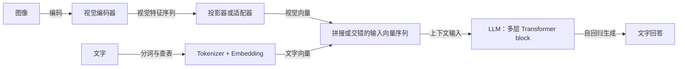

# 多模态模型

## I. 视觉语言模型的基本结构

### 多模态大模型大概是什么结构？

以图像加文本、输出文本的理解模型为例，常见组合是视觉编码器、可学习的连接器和语言模型。图像先变为视觉特征序列，再映射到语言模型可以接收的隐藏维度；文字经 tokenizer 和 embedding 得到向量，二者以拼接或交错序列等方式送入 LLM，后者仍由多层 Transformer block 处理并生成回答。这是 LLaVA 式结构示意，不是所有多模态模型的统一架构。[参考：LLaVA](https://arxiv.org/html/2304.08485v2#S4.SS1)、[Qwen-VL](https://arxiv.org/abs/2308.12966)。

下面是原理示意，箭头表示数据流，省略位置编码、特殊标记和掩码等细节。

### 视觉编码器输出的是图片的文字描述吗？

通常不是。以 ViT 类视觉编码器为例，图像按 patch 等方式编码为一串连续特征向量，表示视觉内容；这些向量不是先生成的一段文字，也不必对应语言词表里的离散 token ID。语言模型最终接收向量，因此可以通过适配器接入视觉表示。[参考：LLaVA 视觉特征与语言嵌入接口](https://arxiv.org/html/2304.08485v2#S4.SS1)。

### 投影器或适配器做什么，维度对齐就能理解图像吗？

连接器通过可学习变换，把视觉特征转成适合语言模型使用的表示，例如从视觉维度 D_v 映射到语言 hidden 维度 D_lm；可以是线性层或 MLP，也有更复杂的适配结构。维度相同只是接口条件，还需图文数据训练来学习跨模态对应关系，不能认为随意变换形状就会自动理解图像。[参考：LLaVA-1.5 的 MLP 连接器](https://arxiv.org/abs/2310.03744)、[LLaVA 特征对齐训练](https://arxiv.org/html/2304.08485v2#S4.SS2)。

### 图像和文字一定要拼成同一条序列吗？

不一定。拼接或交错视觉与文字向量后用自注意力处理是一类方案；另一类如 Flamingo，将视觉特征保留为独立来源，在语言模型中插入 Cross-Attention，让文字表示查询视觉信息。共同目标是使文本生成依赖视觉内容，但连接方式和计算布局不同。[参考：Flamingo](https://arxiv.org/abs/2204.14198)。

### 视频理解模型如何扩展这种结构？

可以对视频抽帧后提取视觉特征，再用时间信息、时空编码或特征压缩等方式组织输入；并非所有模型都是简单独立处理每帧。相比单图，视频需要处理跨帧关系，帧数、分辨率及 token 压缩方式会影响视觉序列长度与后续计算、显存开销。[参考：Flamingo 的视频与视觉特征处理](https://arxiv.org/abs/2204.14198)。

### 图片转成很多向量，本质上就是转成视觉 token 吗？

对，在这里讨论的视觉语言模型中，可以把图片编码为视觉 token 序列，再与文字表示一起由模型处理。但 token 是序列中的表示单元，不一定是离散词表编号：文字通常先分词得到 token ID，再查 embedding 表；视觉输入则经视觉编码器和连接器产生连续向量，不必先变成文字或查语言词表。LLM 最终处理的都是合适维度的向量。一张图片可对应多个位置的表示，例如简化地把 224×224 图片切成 14×14 patch，会有 16×16=256 个 patch 位置；实际视觉 token 数还受特殊 token、分辨率、裁剪/分块与压缩策略影响，不能固定认为一图一个 token 或一个像素一个 token。也有采用离散视觉码本的其他架构，不要与此处连续视觉 token 混为一谈。[参考：LLaVA 视觉特征到语言嵌入的映射](https://arxiv.org/html/2304.08485v2#S4.SS1)。

### 连接器输出与语言 hidden 维度相同，也语义对齐，但不一定对应文字 token 吗？

对。文字 token 的输入 embedding 通常来自有限词表对应的嵌入矩阵的一行；连接器则生成连续的 D 维视觉向量，只需满足语言模型的输入接口，不要求等于任意一个词向量，也不要求映射为文字 token ID。训练让这些视觉表示能被语言模型利用，可称为学习了跨模态语义对齐，但维度相同本身不保证语义对齐，更不表示每个视觉 token 或每个向量分量与文字语义一一对应。视觉 token 可以携带局部形状、颜色及上下文等混合信息，不必先变成一个可命名的词。[参考：LLaVA 的视觉投影与特征对齐训练](https://arxiv.org/html/2304.08485v2#S4.SS1)。

## II. 理解模型与生成模型

### 多模态理解模型和图像生成模型是同一种结构吗？

不必相同。上面的视觉语言模型主要是读取图像并输出文本；生成图像还需要将输出表示变成像素的生成机制。以潜在扩散的 DiT 为例，Transformer 在条件信息和扩散时间步等条件下反复预测去噪所需量，迭代更新图像潜变量，最后交给图像解码器生成图像。它不是把语言模型最后的文字输出头直接当作图片输出头；也存在其他多模态生成架构，不能把所有模型都等同于 DiT。[参考：DiT](https://arxiv.org/html/2212.09748v2)。
