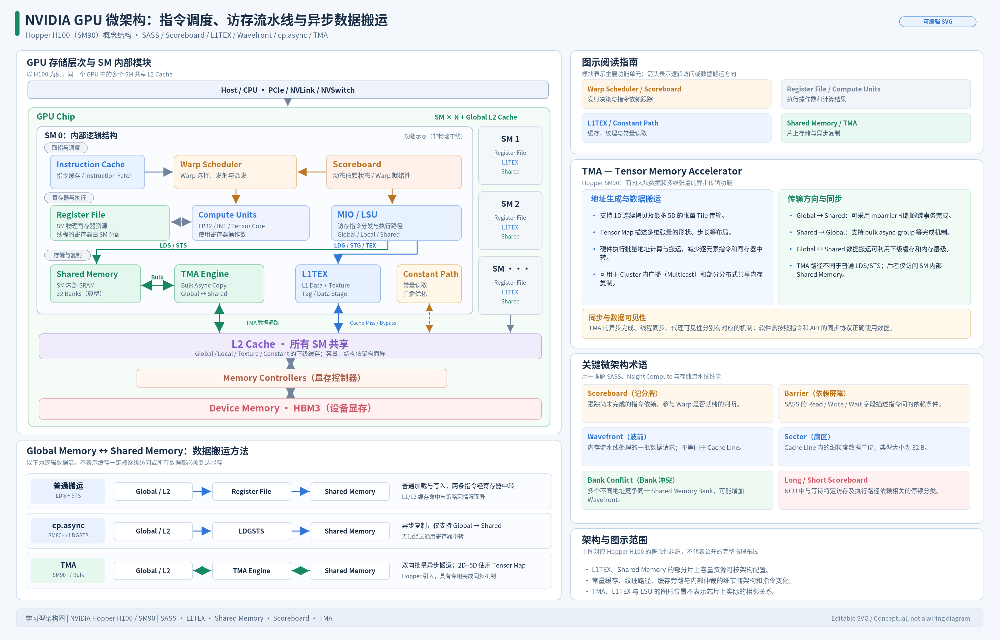
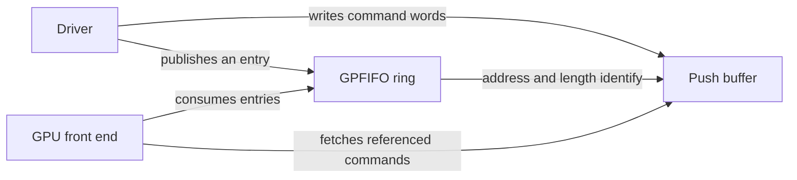

# CUDA Execution Model

Concise entries on hardware organization, control flow, residency, and command submission. Related: [[knowledge/cuda/memory|memory]], [[knowledge/cuda/instructions|instructions]], and [[knowledge/cuda/performance-analysis|performance analysis]].

## I. Hardware Organization

The hardware hierarchy and the execution hierarchy describe different kinds of containment:

- **Hardware:** a GPU contains SMs; an SM contains SMSPs; each SMSP has a warp scheduler, register resources, and execution pipelines. Some resources, including L1/shared memory, are shared across SMSPs.
- **Execution:** a grid contains thread blocks; a block groups its threads into warps. A block is placed on an SM, and its warps are assigned to SMSPs within that SM. A scheduler manages warps; it is not the storage location for all their state.

*Reproduced unchanged from the user's local learning diagram, `nvidia_gpu_microarchitecture_clean_layout.png`. Its original Chinese labels are preserved. This is a Hopper H100 / SM90 conceptual map, not a physical wiring diagram or a specification for every GPU. Shared L1/shared-memory SRAM does not make their access semantics identical; register bypass does not mean cache bypass. Technical references: [Hopper tuning guide](https://docs.nvidia.com/cuda/hopper-tuning-guide/index.html) and [Nsight Compute hardware model](https://docs.nvidia.com/nsight-compute/ProfilingGuide/index.html#metrics-hw-model).*

### 1. Streaming Multiprocessor

**Core idea: An SM hosts resident warps and the resources that execute their instructions.**

An SM contains schedulers, registers, execution pipelines, and on-chip memory resources. An ordinary thread block executes on one SM; several blocks may coexist when resources permit. Multiple SMs share the device's L2 and external-memory system. Exact capacities and partitioning depend on the GPU. [Source: CUDA programming model](https://docs.nvidia.com/cuda/cuda-programming-guide/01-introduction/programming-model.html).

### 2. SM Subpartition (SMSP)

**Core idea: An SMSP is a hardware partition within an SM, with its own scheduler and resident-warp pool.**

In the common four-SMSP organization, a warp is assigned to one SMSP for its ordinary resident lifetime; it is not moved to another scheduler each cycle. Different warps of one block can occupy different SMSPs. H100 supports 16 resident warps per SMSP, totaling 64 per SM; capacities vary by GPU. This placement does not confine every memory operation to SMSP-private resources. [Sources: Nsight hardware model](https://docs.nvidia.com/nsight-compute/ProfilingGuide/index.html#metrics-hw-model); [Hopper limits](https://docs.nvidia.com/cuda/hopper-tuning-guide/index.html#occupancy).

### 3. Warp

**Core idea: CUDA groups threads into 32-thread scheduling groups.**

A lane identifies a thread's position within its warp. An issued SIMT instruction applies to the currently participating threads; a warp need not have all 32 lanes active. A lane is a logical thread position, not a permanently assigned arithmetic core. [Source: advanced kernel programming](https://docs.nvidia.com/cuda/cuda-programming-guide/03-advanced/advanced-kernel-programming.html).

### 4. Thread Block

**Core idea: A block is a cooperating group of threads with shared storage and block synchronization.**

Its warps consume SM residency resources together. Block size therefore influences both scheduling flexibility and [[knowledge/cuda/execution-model#4. Occupancy|occupancy]]. Blocks are independently schedulable in the ordinary grid model; thread-block clusters add explicit cooperation across blocks on supported devices. [Source: CUDA programming model](https://docs.nvidia.com/cuda/cuda-programming-guide/01-introduction/programming-model.html).

## II. Thread Control Flow

This schematic shows two paths taken by different lanes of one illustrative warp; arrows represent execution order, not simultaneous execution on separate cores.

### 1. SIMT Divergence

**Core idea: Threads can choose different paths, but divergent paths use different participating-lane sets.**

Within a warp, different branch outcomes can require separate instruction sequences. This reduces useful lane participation; it does not prevent branching. The diagram is a conceptual serialization example, not a guarantee of path order or compiler lowering. [Source: advanced kernel programming](https://docs.nvidia.com/cuda/cuda-programming-guide/03-advanced/advanced-kernel-programming.html).

### 2. Predication

**Core idea: A predicate enables or disables an instruction's effect for each thread.**

SASS such as `@P0` guards an instruction with a per-thread predicate. Compilers may turn short branches into predicated instructions, avoiding a branch while still spending instruction-issue capacity. An inactive lane and a lane whose predicate is false are related but distinct reasons for not participating. [Source: CUDA Binary Utilities instruction reference](https://docs.nvidia.com/cuda/cuda-binary-utilities/index.html#instruction-set-reference).

For example, a compiler can express `if (x > 0) y = x + 1` as a predicate comparison followed by a guarded addition. Threads whose predicate is false do not update `y`; the guard is per thread, not one Boolean for the entire warp. [Source: PTX predicated execution](https://docs.nvidia.com/cuda/parallel-thread-execution/index.html#predicated-execution).

### 3. Independent Thread Scheduling

**Core idea: Volta and later track thread execution state more independently within a warp.**

Per-thread execution state supports divergence and reconvergence beyond the older warp-lockstep model. Instructions still execute with SIMT groups; threads do not each acquire a CPU-like independent issue engine. Use explicit synchronization such as `__syncwarp()` where communication requires it. [Source: Volta tuning guide](https://docs.nvidia.com/cuda/volta-tuning-guide/index.html#independent-thread-scheduling).

### 4. Branch Prediction

**Core idea: NVIDIA's documented SM execution model handles actual branch outcomes without CPU-style branch prediction and speculative execution.**

Predication or divergent-path execution determines which threads participate. While a warp waits, a scheduler can select another ready warp from its own pool. This hides control-flow latency when other work is available; it does not make branches or divergence free. [Source: CUDA hardware implementation](https://docs.nvidia.com/cuda/cuda-programming-guide/03-advanced/advanced-kernel-programming.html#hardware-implementation).

## III. Scheduling and Residency

### 1. Warp Scheduler

**Core idea: Select a ready resident warp and issue its next instruction.**

Each scheduler selects from the resident warps assigned to its [[knowledge/cuda/execution-model#2. SM Subpartition (SMSP)|SMSP]]. A **resident** warp holds execution resources; an **eligible** warp has a ready instruction and available required resources; an **issued** warp was selected to issue. Switching among that pool does not migrate warps between SMSPs. A scheduler can be idle even when another SMSP has ready work. [Source: Nsight scheduler statistics](https://docs.nvidia.com/nsight-compute/ProfilingGuide/index.html#sections-and-rules).

### 2. Instruction Issue

**Core idea: Issuing an instruction starts work; it is different from completing that work.**

Pipeline execution may continue after its issue cycle. Issue width also varies by architecture: NVIDIA explicitly documents dual issue for Maxwell, while Volta's documented scheduler organization differs. Do not infer a universal one-scheduler/one-slot rule, or infer issue width by comparing two utilization percentages. [Sources: Maxwell scheduling](https://docs.nvidia.com/cuda/maxwell-tuning-guide/index.html#instruction-scheduling); [Volta scheduling](https://docs.nvidia.com/cuda/volta-tuning-guide/index.html#instruction-scheduling).

### 3. Latency Hiding

**Core idea: Execute other ready work while an earlier operation is still pending.**

Other resident warps provide thread-level parallelism; independent instructions in one warp provide instruction-level parallelism. More residency helps only when it creates useful ready work. Adding warps cannot remove a saturated bandwidth or execution-throughput limit. [Source: Volta tuning guide](https://docs.nvidia.com/cuda/volta-tuning-guide/index.html#instruction-scheduling).

### 4. Occupancy

**Core idea: Occupancy measures resident warps relative to the hardware's residency limit.**

For one SM at a given instant:

$$
\mathrm{Occupancy}_{\mathrm{SM}}(t)
= \frac{\text{resident warps on this SM at time }t}
{\text{hardware maximum resident warps per SM}}
\times 100\%.
$$

The numerator includes resident warps waiting on memory or synchronization, not just warps issuing instructions. The denominator is the GPU's hardware limit, not the kernel's block count or the number of arithmetic cores. For example, 32 resident warps on an SM supporting 64 gives 50% occupancy.

**Theoretical occupancy** uses the maximum resident warps permitted by this kernel's launch configuration and resource requirements as the numerator. **Achieved occupancy** uses measured average residency with the profiler's cycle and SM aggregation. Registers, shared memory, threads, and block limits can constrain the numerator. Neither metric directly measures ready-to-issue warps or achieved FLOP/s. [Source: Nsight Compute occupancy analysis](https://docs.nvidia.com/nsight-compute/ProfilingGuide/index.html#sections-and-rules).

Low occupancy can still be efficient if the resident warps provide enough independent work to sustain the target pipelines. Increasing occupancy beyond that point may not help; reducing registers merely to raise occupancy can instead reduce [[knowledge/cuda/execution-model#8. Instruction-Level Parallelism (ILP)|ILP]] or increase [[knowledge/cuda/instructions#4. Register Spilling|spilling]]. A warp does not need exclusive ownership of execution resources to supply useful work continuously. [Source: Volta scheduling and occupancy trade-offs](https://docs.nvidia.com/cuda/volta-tuning-guide/index.html).

### 5. Resource Allocation Granularity

**Core idea: Residency changes in steps because blocks and resource allocations are discrete.**

Only whole blocks fit, and register/shared-memory allocation has architecture-specific granularities and partition constraints. For illustration, a 96 KiB shared-memory budget fits three 32 KiB blocks but only two 33 KiB blocks, ignoring other limits. Register thresholds likewise require the target GPU's occupancy calculator rather than a continuous ratio. [Source: NVIDIA occupancy calculator](https://docs.nvidia.com/nsight-compute/OccupancyCalculatorPythonInterface/index.html).

### 6. SMSP Occupancy

**Core idea: Measure residency in the scheduler's own partition, rather than only across the SM.**

At an instant, SMSP occupancy is `resident warps in this SMSP / maximum resident warps in this SMSP`. SM occupancy sums the resident counts and capacities; with equal SMSP capacities, it is their arithmetic mean at that instant. The SM view captures block-level residency and shared-resource constraints, while the SMSP view exposes local scheduling limits and imbalance. Profiler averages additionally depend on their cycle and unit aggregation. [Source: Nsight hardware model](https://docs.nvidia.com/nsight-compute/ProfilingGuide/index.html#metrics-hw-model).

### 7. Thread-Level Parallelism (TLP)

**Core idea: Keep multiple warps available so another can issue when one stalls.**

For latency hiding, the relevant ready pool belongs to each SMSP, not one freely shared pool across the SM. More resident warps help only if some provide ready work; many warps waiting on the same bottleneck can still leave issue slots empty. [Source: Nsight scheduler statistics](https://docs.nvidia.com/nsight-compute/ProfilingGuide/index.html#sections-and-rules).

### 8. Instruction-Level Parallelism (ILP)

**Core idea: Independent instructions within a warp can overlap, reducing the need for additional warps.**

Several independent accumulation chains can keep issuing while earlier arithmetic results are pending. For Volta, NVIDIA describes hiding core arithmetic latency with four warps per SM and four-way ILP per warp: only 4/64 = 6.25% occupancy. This is a specific arithmetic-latency example, not a guarantee of full-SM utilization or sufficient parallelism for long memory waits. [Source: Volta instruction scheduling](https://docs.nvidia.com/cuda/volta-tuning-guide/index.html#instruction-scheduling).

### 9. In-Order Instruction Issue

**Core idea: Instructions issue in program order within a warp; completion can overlap and occur in a different order.**

If the next instruction cannot issue, hardware does not simply skip it to issue a later independent instruction from the same warp. The scheduler can choose another eligible warp instead. Independent instructions already reached in order can execute concurrently; compiler reordering, asynchronous operations, and independent thread scheduling do not imply CPU-style out-of-order issue. [Source: CUDA hardware implementation](https://docs.nvidia.com/cuda/cuda-programming-guide/03-advanced/advanced-kernel-programming.html#hardware-implementation).

## IV. Command Submission

Arrows distinguish command publication from address references and GPU consumption. Buffers need not be physically adjacent.

### 1. Push Buffer

**Core idea: Store command words for a GPU channel to consume.**

This is driver submission machinery, distinct from a kernel's SASS instruction stream. Storage placement depends on mapping, platform, and driver configuration; CPU preparation does not imply that every command buffer must reside in ordinary host RAM. [Source: NVIDIA UVM channel implementation](https://github.com/NVIDIA/open-gpu-kernel-modules/blob/main/kernel-open/nvidia-uvm/uvm_channel.c).

### 2. GPFIFO

**Core idea: A ring of entries references command-buffer segments by address and length.**

The ring and push buffer are separate objects, not one required contiguous allocation. NVIDIA's UVM code has independent `gpfifo_loc` and `pushbuffer_loc` settings, including configurations with a video-memory GPFIFO and system-memory push buffers. This demonstrates an implementation option, not a universal CUDA placement guarantee. [Sources: UVM channel configuration](https://github.com/NVIDIA/open-gpu-kernel-modules/blob/main/kernel-open/nvidia-uvm/uvm_channel.h); [placement logic](https://github.com/NVIDIA/open-gpu-kernel-modules/blob/main/kernel-open/nvidia-uvm/uvm_channel.c).
