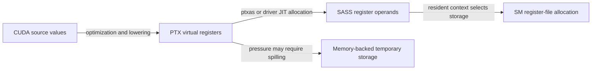

# CUDA Instructions and Computation

Concise entries on compilation, launch state, compute instructions, and dependency management. Related: [[knowledge/cuda/execution-model|execution model]], [[knowledge/cuda/memory|memory]], and [[knowledge/cuda/performance-analysis|performance analysis]].

## I. Compilation and Thread State

Arrows represent compilation and resource assignment, not CPU-style dynamic register renaming.



### 1. PTX

**Core idea: PTX is a virtual instruction set, not the final GPU machine code.**

Its typed virtual registers express intermediate values. The compiler can eliminate or combine values, so source variables, PTX register declarations, and final register counts need not match. PTX can be compiled ahead of time or by the driver's JIT. [Source: NVCC compilation guide](https://docs.nvidia.com/cuda/cuda-programming-guide/02-basics/nvcc.html).

### 2. SASS

**Core idea: SASS is architecture-specific GPU machine assembly.**

`cuobjdump` and `nvdisasm` expose the instructions and operands in a compiled cubin. Mnemonics, encodings, and available operations vary across targets. PTX instruction counts therefore do not directly predict SASS count or execution time. [Source: CUDA Binary Utilities](https://docs.nvidia.com/cuda/cuda-binary-utilities/index.html).

### 3. Register Allocation

**Core idea: The compiler assigns live values to a finite per-thread register budget.**

Non-overlapping lifetimes can reuse a register. SASS `R1` names a register in each thread's context, not one chip-wide location. A resident warp keeps its register state on chip during ordinary warp switching; the physical allocation depends on demand and granularity, rather than a fixed full-size row per thread. See [[knowledge/cuda/execution-model#5. Resource Allocation Granularity|residency thresholds]]. [Sources: PTX register state](https://docs.nvidia.com/cuda/parallel-thread-execution/index.html#register-state-space); [Nsight live-register analysis](https://docs.nvidia.com/nsight-compute/NsightCompute/index.html#source-page).

### 4. Register Spilling

**Core idea: Values that do not fit the register allocation may need memory-backed storage.**

Traditional spills use [[knowledge/cuda/memory#3. Local Memory|local memory]], adding loads and stores that may be cached but consume resources. Reducing registers can increase occupancy while increasing spill traffic. Newer toolchains also offer opt-in shared-memory spilling under specific restrictions; spilling does not universally imply HBM access. [Source: PTX shared-memory spilling pragma](https://docs.nvidia.com/cuda/parallel-thread-execution/index.html#pragma-strings-enable-smem-spilling).

### 5. Special Registers

**Core idea: Thread and block identifiers come from execution state, not hard-coded per-thread instructions.**

PTX exposes `%tid`, `%ctaid`, and related predefined registers. SASS commonly reads identifiers with `S2R`, such as `SR_TID.X`, before arithmetic uses them. Optimization may reuse or transform those values; exact lowering depends on the target. [Sources: PTX special registers](https://docs.nvidia.com/cuda/parallel-thread-execution/index.html#special-registers); [Binary Utilities examples](https://docs.nvidia.com/cuda/cuda-binary-utilities/index.html#cuobjdump).

### 6. Kernel Parameters

**Core idea: Launch arguments are supplied through the kernel's parameter ABI.**

PTX uses `.param` and `ld.param`; NVIDIA GPUs commonly expose these arguments through constant-memory-backed launch state. Threads can load arguments into working registers without the host separately initializing every thread's register file. Argument loads, constant declarations, and uniform-register optimizations are distinct mechanisms. [Source: PTX parameter state space](https://docs.nvidia.com/cuda/parallel-thread-execution/index.html#parameter-state-space).

### 7. Local Stack Frame

**Core idea: A local address is interpreted within a thread's private local-memory context.**

Identical local offsets in different threads do not identify the same storage. A prologue such as `IMAD.MOV ... c[0x0][0x28]` can establish frame-related state in a particular ABI; that slot is not a portable stack-base specification. Interpret the complete prologue, local instructions, and target ABI together. [Sources: PTX local state](https://docs.nvidia.com/cuda/parallel-thread-execution/index.html#local-state-space); [NVIDIA disassembly example](https://docs.nvidia.com/cuda/cuda-binary-utilities/index.html#nvdisasm).

## II. Compute Instructions

### 1. Integer Instructions

**Core idea: The `I` in `IADD3`, `IMAD`, and `ISETP` denotes integer operations.**

These perform integer addition, multiply-add, and predicate-setting comparisons. It does not mean “immediate”; immediates are literal operands. An `IMAD`-family instruction may also serve address arithmetic or a move-like form, so inspect its suffixes and operands. [Source: NVIDIA instruction reference](https://docs.nvidia.com/cuda/cuda-binary-utilities/index.html#instruction-set-reference).

### 2. Packed Low-Precision Arithmetic

**Core idea: A packed instruction operates on multiple low-precision elements in one register representation.**

`__half2` stores two FP16 values; intrinsics such as `__hadd2` operate elementwise on the pair. This can raise element throughput on supporting hardware, but an arbitrary FP32 instruction does not automatically become two FP16 operations. Packing, conversions, and hardware throughput determine the gain. [Source: CUDA Half2 arithmetic](https://docs.nvidia.com/cuda/archive/12.8.2/cuda-math-api/cuda_math_api/group__CUDA__MATH____HALF2__ARITHMETIC.html).

### 3. Tensor Cores

**Core idea: Specialized execution resources accelerate matrix multiply-accumulate operations.**

They operate on supported matrix tiles and data types, with architecture-specific layouts and accumulation rules. They are a separate compute path from ordinary scalar/vector arithmetic, including packed FP16. Shape, alignment, data movement, and instruction selection affect realized throughput. [Source: NVIDIA matrix multiplication guide](https://docs.nvidia.com/deeplearning/performance/dl-performance-matrix-multiplication/index.html).

### 4. Structured Sparsity

**Core idea: Supported sparse matrix instructions skip work using a constrained sparsity pattern and metadata.**

Ampere Sparse Tensor Cores support a 2:4 pattern in a designated operand: each supported group of four has at most two nonzero values. Compressed values and position metadata let the instruction avoid zero products. The advertised 2x effective math throughput is not a guaranteed end-to-end speedup, and arbitrary zeros in a dense matrix do not activate it. General sparse formats instead require suitable sparse kernels. [Source: NVIDIA structured sparsity explanation](https://developer.nvidia.com/blog/accelerating-inference-with-sparsity-using-ampere-and-tensorrt/).

## III. Instruction Dependencies

### 1. Scoreboard

**Core idea: Track outstanding dependencies so instructions do not use unavailable values.**

A warp can remain resident while a dependency prevents its next instruction from issuing. Nsight's [[knowledge/cuda/performance-analysis#3. Long Scoreboard|Long Scoreboard]] and [[knowledge/cuda/performance-analysis#4. Short Scoreboard|Short Scoreboard]] classify waits by operation path; they do not describe two universal fixed latency ranges. [Source: Nsight dependency analysis](https://docs.nvidia.com/nsight-compute/NsightCompute/index.html#source-page).

### 2. SASS Dependency Barriers

**Core idea: Instruction control fields describe dependencies on variable-latency work.**

In published Volta/Turing reverse engineering, a write barrier tracks result readiness, a read barrier protects source registers from premature reuse, and a wait mask names dependencies to await. The compiler encodes the producer's barrier index and the consumer's wait mask in SASS control fields; hardware tracks the corresponding [[knowledge/cuda/instructions#3. Dependency Counters|dependency counters]]. These are distinct from thread-block rendezvous barriers. Treat this as a research model for the analyzed targets, not a complete public specification of every implementation. [Source: Jia et al., Turing microbenchmarking, Section 2.1](https://arxiv.org/html/1903.07486v1).

### 3. Dependency Counters

**Core idea: Count unfinished operations in a waiting group, rather than identify each unavailable value.**

In the microbenchmark-derived Turing/Ampere model, each warp has six 6-bit counters, `SB0`–`SB5`, with values from 0 to 63. For result dependencies, a producer increments its assigned counter after issue and decrements it after writeback; a consumer's wait mask requires the selected counters to be zero. The scheduler checks the warp's counters, not 32 separate per-thread flags. Read dependencies instead decrement after source operands have been read. [Source: Huerta et al., Section 4](https://arxiv.org/html/2503.20481v1#S4).

Independent producers may share a counter when a consumer needs all their results. This illustrative annotation is not literal SASS syntax:

```text
LDS  R1, [addr1]       {write dependency: SB0}
LDS  R2, [addr2]       {write dependency: SB0}
LDS  R3, [addr3]       {write dependency: SB0}
FFMA R4, R1, R2, R3   {wait: SB0 == 0}
```

If all three loads issue before any completes, `SB0` follows `0 → 1 → 2 → 3 → 2 → 1 → 0`. Sharing groups their completion conditions; it does not create dependencies between the loads. It saves tracking slots, but a consumer needing only `R1` would also wait for the other loads; separate slots can preserve that earlier opportunity. A load split into several [[knowledge/cuda/memory#4. Wavefront|wavefronts]] remains one producer here, not one counter increment per lane or wavefront. [Source: Huerta et al., Section 4](https://arxiv.org/html/2503.20481v1#S4).

### 4. Thread-Block Barrier

**Core idea: A block barrier coordinates participating threads and makes required prior accesses visible.**

`__syncthreads()` supports cooperative use of shared data. It is not a SASS read/write dependency-barrier index. Divergent use must satisfy CUDA's participation rules; waiting for peers can produce a [[knowledge/cuda/performance-analysis#5. Barrier Stall|Barrier stall]], a different diagnosis from waiting on a load result. [Source: SIMT kernel synchronization](https://docs.nvidia.com/cuda/cuda-programming-guide/02-basics/writing-cuda-kernels.html).
