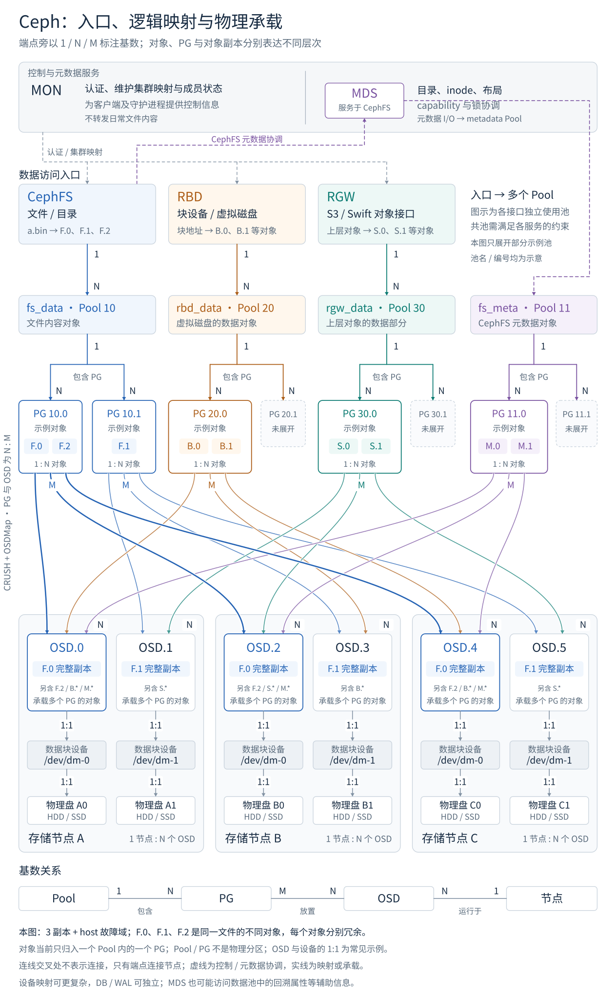

# Ceph Data Placement

The diagram separates logical membership, placement, and physical hosting. Solid lines represent mapping or storage; dashed lines represent control or metadata coordination. Cardinalities label relationships, not packet hops.

*Original explanatory SVG from the conversation “查看 Ceph 信息与排查命令”, reproduced unchanged with its Chinese labels. Names, IDs, and topology are illustrative. The example uses three replicas across host failure domains; the OSD/device/disk 1:1 mapping is a common example, not a universal constraint. DB/WAL devices and inode backtraces can introduce additional paths. References: [Ceph placement](https://docs.ceph.com/en/tentacle/rados/operations/placement-groups/) and [CRUSH](https://docs.ceph.com/en/tentacle/rados/operations/crush-map/).*

## I. Logical Data Units

### 1. RADOS Object

**Core idea: Store one logical object, whose physical representation can span OSDs.**

An object belongs to a pool and maps to one PG under the current mapping. Copies or encoded shards can occupy several hosts without creating several logical objects or PG memberships. Object identity includes pool and namespace context, not just its name. [Source: pools and namespaces](https://docs.ceph.com/en/tentacle/rados/operations/pools/).

### 2. Pool

**Core idea: Group objects under a configured placement and protection policy.**

A pool contains many PGs; each PG belongs to one pool. Different pools can share OSDs, so pools are not physical disk partitions. Sharing a pool across applications also requires compatible layouts and supported configuration; it does not provide cross-interface data interpretation. [Source: pool semantics](https://docs.ceph.com/en/tentacle/rados/operations/pools/).

### 3. Placement Group (PG)

**Core idea: Manage placement and recovery for a group of objects.**

Many objects map to a PG, and that PG maps to an OSD set. An OSD holds data for many PGs, possibly from different pools. A PG is neither a file fragment nor a standalone server. In `10.1a`, `10` is the pool ID and `1a` is the hexadecimal PG index. [Source: placement groups](https://docs.ceph.com/en/tentacle/rados/operations/placement-groups/).

### 4. File Layout

**Core idea: Translate file offsets into RADOS object offsets before applying redundancy.**

CephFS layout specifies the data pool, object size, stripe unit, and stripe count. In a simple sequential 4 MiB-object example, a 12 MiB file occupies three distinct objects; those objects can map to different PGs. Four MiB is an example, not a universal size. [Source: CephFS file layouts](https://docs.ceph.com/en/tentacle/cephfs/file-layouts/).

## II. Placement and Protection

### 1. CRUSH

**Core idea: Compute placement from rules and cluster topology instead of consulting a per-object location server.**

Controlled Replication Under Scalable Hashing uses device weights and hierarchical placement rules. Clients combine cluster maps with placement calculations to find the responsible OSDs. Membership or weight changes can remap data. [Source: CRUSH maps](https://docs.ceph.com/en/tentacle/rados/operations/crush-map/).

### 2. Primary OSD

**Core idea: Coordinate a PG's peering and client writes through its designated primary.**

The primary is conventionally the first OSD in the acting set. A PG is a logical grouping: requests go to actual OSDs, not through a separate PG process. The primary coordinates the other replicas or shards. [Source: PG primary](https://docs.ceph.com/en/tentacle/rados/operations/pg-concepts/).

### 3. Replica Placement

**Core idea: Place a full copy of each object on each participating replica OSD.**

With three [[knowledge/distributed-systems/reliability#1. Replication|replicas]], the diagram's `F.0`, `F.1`, and `F.2` each have three full copies. File splitting and redundancy are separate steps. For replicated pools, `size` sets the intended replica count; `min_size` constrains service with missing replicas, not their freshness. [Source: replicated pool configuration](https://docs.ceph.com/en/tentacle/rados/operations/pools/).

### 4. Erasure-Coded Placement

**Core idea: Place an object's encoded shards on its PG's OSD set.**

A `k+m` pool uses [[knowledge/distributed-systems/reliability#2. Erasure Coding|erasure coding]], not `k+m` full copies. A teaching `2+1` example splits one object's encoded representation across three OSDs; the logical object still belongs to one PG. Small writes, alignment, and recovery introduce costs beyond ideal capacity ratios. [Source: erasure-coded pools](https://docs.ceph.com/en/tentacle/rados/operations/erasure-code/).

### 5. CRUSH Failure Domain

**Core idea: Constrain redundant placements to different topology buckets.**

A `host` [[knowledge/distributed-systems/reliability#3. Failure Domain|failure domain]] separates a PG's copies or shards across hosts, provided the eligible topology supports it. Different OSD IDs alone do not imply different hosts. Many PGs and pools can still share the same hosts. [Source: CRUSH rules](https://docs.ceph.com/en/tentacle/rados/operations/crush-map/).

## III. Placement Changes and Recovery

### 1. OSDMap Epoch

**Core idea: Version the cluster state used to interpret placement.**

An epoch identifies a version of the OSDMap. Compare mappings and device observations at compatible times; a current assignment does not erase the history of earlier assignments or writes. [Source: PG epochs and intervals](https://docs.ceph.com/en/tentacle/rados/operations/pg-concepts/).

### 2. Up Set and Acting Set

**Core idea: Distinguish intended placement from the OSDs currently assigned responsibility.**

The up set is the placement target under the map; the acting set can differ through temporary mappings during changes. These are ordered sets for a PG, not synonyms for all online OSDs. Inspect them with `sudo ceph pg map <pg-id>`. [Source: PG sets](https://docs.ceph.com/en/tentacle/rados/operations/monitoring-osd-pg/#pg-sets).

### 3. Peering

**Core idea: Establish authoritative PG history before safely serving data.**

OSDs reconcile logs and object state; agreement does not mean every replica already has every updated byte. Historical participants may still be needed after leaving the current acting set. Several online OSDs therefore do not prove that recovery can proceed safely. [Sources: peering concepts](https://docs.ceph.com/en/tentacle/rados/operations/pg-concepts/); [blocked peering](https://docs.ceph.com/en/tentacle/rados/troubleshooting/troubleshooting-pg/#placement-group-down-peering-failure).

### 4. Recovery and Backfill

**Core idea: Restore data after history and placement have been established.**

Recovery brings missing or outdated replicas/shards up to date; backfill transfers PG data when a destination needs broader synchronization, such as after remapping. Peering, data transfer, and becoming fully clean are different milestones. [Source: PG recovery states](https://docs.ceph.com/en/tentacle/rados/operations/monitoring-osd-pg/).
