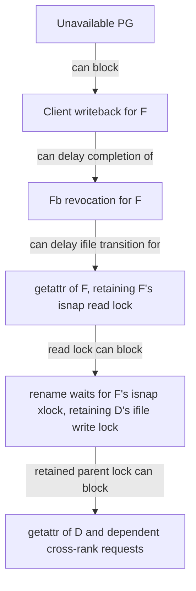

# Ceph Status and Troubleshooting

Reusable interpretations and read-only queries from the learning conversation. Examples use fictional identifiers; administrative commands and output fields must match the deployed version.

## I. Health and Storage State

### 1. HEALTH_ERR

**Core idea: Report severe health checks without implying that every service has stopped.**

Read `sudo ceph health detail` to identify each check's scope. Counts may overlap or describe different populations; MON quorum, daemon liveness, filesystem access, and data availability are separate observations. [Source: health checks](https://docs.ceph.com/en/tentacle/rados/operations/health-checks/).

### 2. OSD up/down and in/out

**Core idea: Separate reachability from participation in placement.**

`up/down` concerns whether an OSD is reachable; `in/out` concerns placement membership. An OSD can be `down` yet `in`, or `up` yet `out`. Equal aggregate counts do not prove that two lists identify the same OSDs. [Source: OSD monitoring](https://docs.ceph.com/en/tentacle/rados/operations/monitoring-osd-pg/#monitoring-osds).

### 3. PG State

**Core idea: Read a PG's combined state flags as related properties of one group.**

`active` means the PG can service I/O subject to applicable restrictions; `clean` means its expected data copies are current. `down`/inactive describes availability trouble, while `inconsistent` records discrepancies. A PG can satisfy several flags; counts are not necessarily additive. [Source: PG monitoring](https://docs.ceph.com/en/tentacle/rados/operations/monitoring-osd-pg/).

### 4. Scrubbing

**Core idea: Check stored replicas or shards for discrepancies.**

Scrubbing checks object metadata; deep scrubbing additionally checks contents. Scrub-error counts are not counts of broken disks or user files. An inconsistent PG is a diagnosis requiring object-level investigation, not automatic proof that every contained file is lost. [Source: scrub and inconsistency checks](https://docs.ceph.com/en/tentacle/rados/operations/health-checks/).

### 5. Capacity Pressure

**Core idea: Evaluate the constrained OSD or pool rather than only total free space.**

Placement rules and uneven utilization can leave particular OSDs near thresholds while the cluster still has free capacity. `nearfull`, backfill limits, and full conditions are different severities with different effects. [Source: capacity health checks](https://docs.ceph.com/en/tentacle/rados/operations/health-checks/).

### 6. noout

**Core idea: Suppress automatic out-marking of down OSDs within the flag's scope.**

This can reduce remapping during maintenance, but it does not repair an OSD or stop every form of recovery. Distinguish cluster-wide flags from OSD/group-scoped settings. [Source: OSD maintenance flags](https://docs.ceph.com/en/tentacle/rados/troubleshooting/troubleshooting-osd/#stopping-without-rebalancing).

### 7. Authentication Health Checks

**Core idea: Identify insecure credentials, ticket issuance, or compatibility settings separately from data-path failures.**

Reported entities are Ceph identities, not necessarily people or currently running processes. Such warnings do not establish an intrusion. Migration must account for daemon/client compatibility, keys, and tickets rather than interpreting every warning as a failed daemon. [Source: authentication health checks](https://docs.ceph.com/en/tentacle/rados/operations/health-checks/).

### 8. Crash Report

**Core idea: Preserve a daemon failure event independently of its current liveness.**

A recent-crash count is not the number of daemons currently down. Correlate entity, timestamp, version, and error fields; the same OSD ID across reinstalls does not establish the same physical device. [Sources: crash health checks](https://docs.ceph.com/en/tentacle/rados/operations/health-checks/); [OSD diagnosis](https://docs.ceph.com/en/tentacle/rados/troubleshooting/troubleshooting-osd/).

### 9. Metadata Damage

**Core idea: Report corrupt or missing filesystem metadata encountered by MDS.**

`MDS_DAMAGE` can affect a subtree while MDS continues serving other paths. Distinguish it from slow I/O and from RADOS scrub discrepancies; similar timing or counts do not establish one cause. [Source: CephFS metadata damage](https://docs.ceph.com/en/tentacle/cephfs/health-messages/#mds-damage).

## II. Requests and Blocking

### 1. Slow MDS Request

**Core idea: Count requests still incomplete after the complaint threshold.**

The warning describes a current backlog, not all historically slow completed operations. Each rank maintains its own work. A rank in `active` state can still have blocked requests, and the largest backlog alone does not identify the root cause. [Source: `MDS_SLOW_REQUEST`](https://docs.ceph.com/en/tentacle/cephfs/health-messages/#mds-slow-request).

### 2. Objecter Request

**Core idea: Trace a particular daemon's outstanding RADOS operations.**

MDS `objecter_requests` concerns I/O issued by that MDS, not every client's direct file-data I/O. Correlate objects, pools, mappings, and PG queries. A small number of backend waits can block many upper-level metadata requests. [Source: MDS/backend troubleshooting](https://docs.ceph.com/en/tentacle/cephfs/troubleshooting/).

### 3. getattr Batching

**Core idea: Let compatible attribute queries share a leading request's work.**

Several waiting requests can join a batch for an inode. A large batch does not mean each follower independently holds a lock or performs one backend read. Track the leading request when following the wait chain. [Source: Ceph 20.2.4 batching implementation](https://github.com/ceph/ceph/blob/7f793731f1b39eb4f465e960113d2363c311b964/src/mds/Server.cc#L4239-L4249).

### 4. Request Rate

**Core idea: Measure arrivals from counter changes over time, not from a backlog snapshot.**

For a matching cumulative request counter, mean rate is `(C_end - C_start) / elapsed_seconds`. Exclude resets and daemon/rank changes; retries and forwarding affect the counting unit. Arrival, reply, and successful-completion rates are different quantities. This is a measurement rule, not a claim that every counter named "request" counts unique user operations.

### 5. Lock Wait Chain

**Core idea: Follow retained resources to understand how a local wait can affect other objects and ranks.**

One operation can hold earlier locks while waiting for another resource. This can widen the impact beyond directly unavailable data; long waiting alone does not establish deadlock without a dependency cycle. Distinguish the initial trigger from later amplification. [Sources: MDS locking](https://docs.ceph.com/en/latest/dev/mds_internals/locking/); [CephFS blocking diagnosis](https://docs.ceph.com/en/tentacle/cephfs/troubleshooting/).

The schematic below is an explanatory synthesis of the conversation's lock pattern, not a universal rename sequence. Let `F` be a file moved out of parent directory `D`; assume the displayed lock holds have been confirmed. Arrows show possible blocking propagation, not data transfer.

A pending `Fb` revocation does not itself prove dirty data or PG failure. Prove each link separately. Switching MDS cannot remove an unchanged shared-storage dependency; likewise, capability revocation need not originate from [[knowledge/distributed-systems/ceph/cephfs#6. MDS Cache Recall|cache pressure]].

### 6. D State

**Core idea: Identify a Linux task in uninterruptible sleep, often while waiting for I/O.**

This is a task state, not a diagnosis of Ceph capability failure. Examine the blocked stack and storage/client evidence to determine what the task actually awaits. [Source: Linux process-state definitions](https://man7.org/linux/man-pages/man5/proc_pid_stat.5.html).

### 7. Block-Device I/O Error

**Core idea: Trace the failing logical device through its physical storage path.**

An I/O error can originate from media, a controller, a cable, or another path component. Inspect dependencies with `lsblk -s` and correlate stable identifiers such as serial numbers; `/dev/dm-*` and `/dev/sd*` names can change. [Sources: OSD troubleshooting](https://docs.ceph.com/en/tentacle/rados/troubleshooting/troubleshooting-osd/); [lsblk](https://man7.org/linux/man-pages/man8/lsblk.8.html).

### 8. Lost OSD

**Core idea: Declare an unavailable OSD lost rather than continue depending on its missing history or data.**

A PG may need a historical OSD even when it is absent from the current acting set. A "starting or marking this OSD lost may let us proceed" message identifies a recovery obstacle, not a repair instruction. Declaring loss can abandon updates and does not fix the underlying device. [Source: blocked peering and lost OSDs](https://docs.ceph.com/en/tentacle/rados/troubleshooting/troubleshooting-pg/#placement-group-down-peering-failure).

### 9. Oldest Client/Flush TID

**Core idea: Tell MDS which completed client transactions it can forget.**

If the client's oldest transaction marker does not advance, MDS can retain completed-request bookkeeping. This differs from unfinished file I/O or journal-segment trimming, although all can contribute to resource pressure. [Source: oldest-TID health checks](https://docs.ceph.com/en/tentacle/cephfs/health-messages/#mds-client-oldest-tid-mds-client-oldest-tid-many).

### 10. Slow Metadata I/O

**Core idea: Identify backend operations that an MDS has been waiting to complete.**

This is a storage-operation view, whereas slow MDS requests describe frontend metadata work. A frontend request may wait on locks instead, and one backend operation can hold up many frontend requests. Inspect [[knowledge/distributed-systems/ceph/operations#2. Objecter Request|Objecter requests]] to connect layers. [Source: CephFS health checks](https://docs.ceph.com/en/tentacle/cephfs/health-messages/).

## III. Read-Only Queries

Run from an environment with the intended Ceph configuration, identity, and network access. Replace angle-bracket placeholders before executing; `sudo` only grants local privileges. These queries inspect state and do not perform repairs.

| Purpose | Query |
| --- | --- |
| Overall health and detailed checks | `sudo ceph -s`; `sudo ceph health detail` |
| Local client versus daemon versions | `sudo ceph --version`; `sudo ceph versions` |
| Deployment backend | `sudo ceph orch status` |
| OSD topology and utilization | `sudo ceph osd tree`; `sudo ceph osd df tree` |
| Pool IDs, policies, and capacity | `sudo ceph osd lspools`; `sudo ceph osd pool ls detail`; `sudo ceph df` |
| PG overview, placement, and history | `sudo ceph pg stat`; `sudo ceph pg map <pg-id>`; `sudo ceph pg <pg-id> query` |
| Filesystems, ranks, and maps | `sudo ceph fs ls`; `sudo ceph fs status`; `sudo ceph fs dump` |
| Available MDS diagnostic commands | `sudo ceph tell mds.<fs-name>:<rank> help` |
| MDS requests, locks, and backend operations | `sudo ceph tell mds.<fs-name>:<rank> ops locks`; `sudo ceph tell mds.<fs-name>:<rank> objecter_requests` |
| Client sessions and cumulative counters | `sudo ceph tell mds.<fs-name>:<rank> client ls`; `sudo ceph tell mds.<fs-name>:<rank> perf dump` |
| OSD host/device metadata | `sudo ceph osd find <osd-id>`; `sudo ceph osd metadata <osd-id>` |
| Crash history and one report | `sudo ceph crash ls`; `sudo ceph crash info <crash-id>` |

Diagnostic commands and counter schemas vary by version; use the daemon's `help` output to confirm internal commands. Record timestamps, map epochs, daemon identity, and command failures alongside results. MDS lock dumps, Objecter lists, and client-side requests are complementary views. [References: cluster monitoring](https://docs.ceph.com/en/tentacle/rados/operations/monitoring/); [CephFS troubleshooting](https://docs.ceph.com/en/tentacle/cephfs/troubleshooting/).
